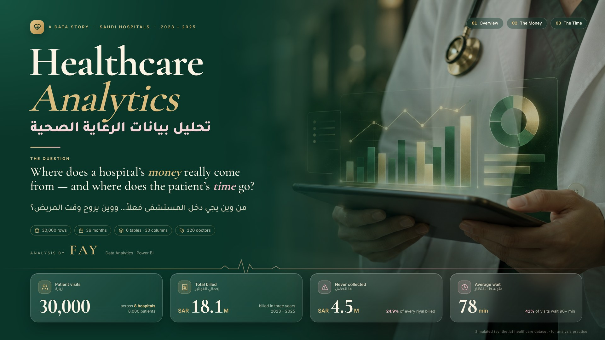
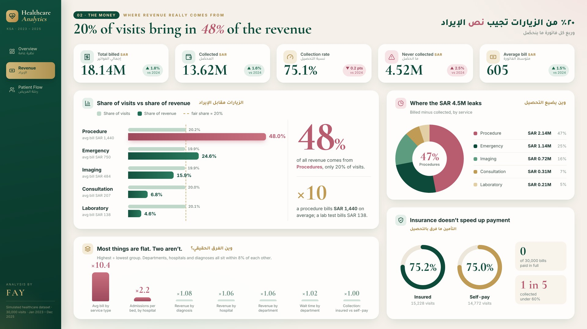
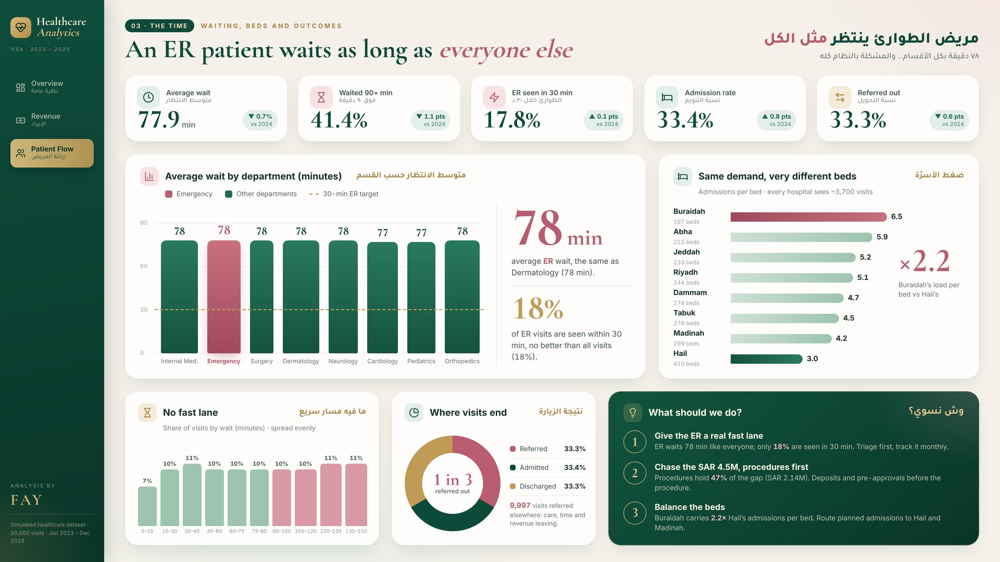

<h1 align="center">Healthcare Analytics Dashboard</h1>

<p align="center">
  A three-page Power BI report on hospital visits, billing and patient flow across eight medical centers in Saudi Arabia (2023–2025).
</p>

<p align="center">
  
  
  
  
  
  
</p>

<p align="center">
  
</p>

<table>
  <tr>
    <td width="50%"></td>
    <td width="50%"></td>
  </tr>
  <tr>
    <td align="center"><b>Revenue</b></td>
    <td align="center"><b>Patient Flow</b></td>
  </tr>
</table>

A short walkthrough video is available in [`assets/Healthcare_Analytics_Walkthrough.mp4`](assets/Healthcare_Analytics_Walkthrough.mp4), and all pages are collected in [`docs/Healthcare_Analytics_Screens.pdf`](docs/Healthcare_Analytics_Screens.pdf).

## Objectives

- Track overall activity: visits, patients, hospitals and doctors.
- Show where revenue comes from and where billed money is not collected.
- Measure waiting times, emergency response against a 30-minute target, admissions and referrals.
- Compare capacity load across hospitals (admissions per bed).
- Compare 2025 with 2024 for every headline KPI.

## Dataset

`data/Healthcare_Analytics_Clean_30000.xlsx` — synthetic, simulated data (not real clinical records), covering 2023 to 2025.

| Sheet | Rows | Contents |
| --- | ---: | --- |
| Visits | 30,000 | Visit date, patient, facility, department, provider, diagnosis, service, wait minutes, outcome |
| Billing | 30,000 | Charge and collected amount (SAR) per visit, payment status |
| Patients | 8,000 | Gender, age, city, payment type (Insured / Self-pay) |
| Facilities | 8 | Medical centers in Riyadh, Jeddah, Dammam, Hail, Abha, Madinah, Buraidah and Tabuk, with bed counts |
| Providers | 120 | Department and facility per provider |
| Services | 5 | Consultation, Emergency, Imaging, Laboratory, Procedure, with base cost |

In Power Query the sheets are joined into a single visit-level `Visits` table, with added columns for `Year`, `Uncollected_SAR`, wait bands and age groups. A calculated `Date` table supports the trends.


## Data cleaning & preparation

Data cleaning and preparation by **Fay Naif**. Each sheet of the workbook was checked before building the model:

| Sheet | Rows | Blank cells | Duplicate IDs |
| --- | ---: | ---: | ---: |
| Visits | 30,000 | 0 | 0 |
| Billing | 30,000 | 0 | 0 |
| Patients | 8,000 | 0 | 0 |
| Providers | 120 | 0 | 0 |
| Facilities | 8 | 0 | 0 |
| Services | 5 | 0 | 0 |

Every visit has exactly one bill and a known patient, no collected amount is higher than its charge, and no wait time is negative.

**Power Query steps** (full code in [`power-query/queries.pq`](power-query/queries.pq)): load the six sheets through the `FilePath` parameter → join Billing, Patients, Services and Facilities onto Visits (left joins on their IDs) → select the 18 columns → set data types → add calculated columns for year, uncollected amount, wait bands and age groups. A DAX `Date` table supports the trends.

```powerquery
J1 = Table.ExpandTableColumn(Table.NestedJoin(V, {"Visit_ID"}, B, {"Visit_ID"}, "B", JoinKind.LeftOuter), "B", {"Charge_SAR", "Collected_SAR"}),
J2 = Table.ExpandTableColumn(Table.NestedJoin(J1, {"Patient_ID"}, Pt, {"Patient_ID"}, "P", JoinKind.LeftOuter), "P", {"Gender", "Age", "City", "Payment_Type"}, {"Gender", "Age", "Patient_City", "Payment_Type"}),
```

## Report pages

| Page | Focus |
| --- | --- |
| **Overview** | Cover page with the headline numbers: visits, total billed, uncollected amount, average wait |
| **Revenue** | Billed vs. collected, collection rate, uncollected amount by service, visit share vs. revenue share, insured vs. self-pay |
| **Patient Flow** | Average wait and wait distribution, share of visits over 90 minutes, emergency visits seen within 30 minutes, admission and referral rates, admissions per bed by hospital |

## Key measures

The semantic model contains 65 DAX measures; the full list is in [`dax/DAX-measures.dax`](dax/DAX-measures.dax).

| Group | Measures |
| --- | --- |
| Core | Visits, Patients, Hospitals, Doctors |
| Money | Total Billed, Total Collected, Uncollected, Collection Rate, Avg Bill, Revenue Share, Gap Share |
| Time | Avg Wait (min), % Wait 90+ min, % Seen in 30 min, ER Seen in 30 min, Admission Rate, Referral Rate |
| Capacity | Total Beds, Admissions per Bed, Visits per Bed, Bed Load Gap (x) |
| Time intelligence | YoY % / pts for billed, collected, collection rate, uncollected, average bill, wait and outcome rates (2025 vs 2024) |

```dax
Collection Rate =
    DIVIDE ( [Total Collected], [Total Billed] )

% Wait 90+ min =
    DIVIDE ( CALCULATE ( [Visits], Visits[Wait_Minutes] > 90 ), [Visits] )

Bed Load Gap (x) =
    VAR t = ADDCOLUMNS ( ALL ( Visits[Facility_Name] ), "apb", [Admissions per Bed] )
    RETURN DIVIDE ( MAXX ( t, [apb] ), MINX ( t, [apb] ) )
```

## Headline figures

| KPI | Value | 2025 vs 2024 |
| --- | ---: | ---: |
| Visits | 30,000 | |
| Total billed | SAR 18.14M | ▲ 1.8% |
| Collected | SAR 13.62M | ▲ 1.6% |
| Collection rate | 75.1% | ▼ 0.2 pts |
| Uncollected | SAR 4.52M | ▲ 2.5% |
| Average bill | SAR 605 | ▲ 1.5% |
| Average wait | 77.9 min | ▼ 0.7% |
| Visits waiting 90+ min | 41.4% | ▼ 1.1 pts |
| ER seen within 30 min | 17.8% | ▲ 0.1 pts |
| Admission rate | 33.4% | ▲ 0.8 pts |

Procedures are about 20% of visits but 48% of billed revenue, and admissions per bed range from 6.5 (Buraidah) to 3.0 (Hail).

## Python &amp; SQL

The data checks and the main analysis are also written in code, so they can be re-run outside Power BI:

| File | What it does |
| --- | --- |
| [`python/data_cleaning.py`](python/data_cleaning.py) | Checks the six sheets and the links between them, joins them into one visit-level table, adds year, uncollected amount, wait bands and age groups, and prints the headline KPIs |
| [`python/load_to_sqlite.py`](python/load_to_sqlite.py) | Loads the data into a SQLite database and runs every query in `sql/analysis.sql` |
| [`sql/analysis.sql`](sql/analysis.sql) | 8 queries with joins: KPIs, revenue share by service, insured vs. self-pay, wait bands, ER seen within 30 minutes, admissions per bed, outcome rates, 2025 vs. 2024 |

```bash
pip install -r python/requirements.txt
python python/data_cleaning.py
python python/load_to_sqlite.py
```

The results match the figures in the dashboard.

## Tools

- **Power BI Desktop** — report, semantic model and custom theme (`Emerald Blush`)
- **DAX** — measures and time intelligence
- **Power Query (M)** — joining the six sheets into one model table
- **Excel** — source workbook
- **HTML / CSS** — designed page backgrounds used as canvas images
- **Python (pandas)** — data checks and preparation
- **SQL (SQLite)** — analysis queries

## Project structure

```
Healthcare-Analytics-Dashboard/
├── dashboard/
│   ├── Healthcare_Story.pbip              # open this in Power BI Desktop
│   ├── Healthcare_Story.Report/           # report pages, visuals, backgrounds
│   ├── Healthcare_Story.SemanticModel/    # data model, Power Query, DAX
│   ├── theme/Emerald_Blush_Theme.json     # Power BI theme
│   └── page-designs/                      # HTML source of the page backgrounds
├── dax/
│   └── DAX-measures.dax
├── power-query/
│   └── queries.pq
├── python/
│   ├── data_cleaning.py
│   ├── load_to_sqlite.py
│   └── requirements.txt
├── sql/
│   └── analysis.sql
├── data/
│   └── Healthcare_Analytics_Clean_30000.xlsx
├── screenshots/                           # images used in this README
├── docs/
│   └── Healthcare_Analytics_Screens.pdf
├── assets/
│   └── Healthcare_Analytics_Walkthrough.mp4
├── README.md
└── README_AR.md
```

## How to open

1. Clone the repository or download it as a ZIP and extract it.
2. Open `dashboard/Healthcare_Story.pbip` in Power BI Desktop.
3. Click **Home → Refresh**. The model includes an embedded copy of the data, so the visuals load without moving any files.
4. Optional: to read directly from the Excel file, go to **Transform data → Edit parameters → FilePath** and enter the full path to `data/Healthcare_Analytics_Clean_30000.xlsx`, then refresh.

If Power BI shows a privacy-levels prompt, set **File → Options and settings → Options → Privacy → Ignore the Privacy Levels** and refresh again. To keep a single file, use **File → Save as → Power BI file (.pbix)**.

## نبذة بالعربي

لوحة Power BI من ثلاث صفحات لتحليل بيانات الرعاية الصحية في ثمانية مراكز طبية بالمملكة (2023–2025): الزيارات، الفواتير والتحصيل، وأوقات الانتظار والتنويم والتحويل، مع مقارنة 2025 بـ 2024. البيانات محاكاة (synthetic) وليست سجلات حقيقية. التفاصيل الكاملة في [README_AR.md](README_AR.md).

---

<p align="center"><b>Author:</b> Fay Naif · <a href="https://github.com/fay-naif">GitHub</a> · <a href="https://www.linkedin.com/in/fay-naif-4295663b7">LinkedIn</a></p>
